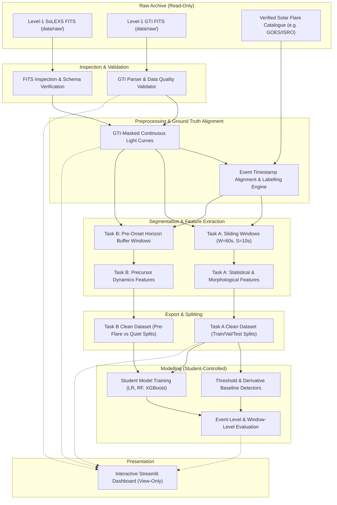

# System Architecture: SOLARIS-A1

## Overview
This document specifies the software and data architecture for project `SOLARIS-A1` (*Machine Learning-Based Solar Flare Detection and Pre-Flare Activity Analysis Using Aditya-L1 SoLEXS Observations*).

The architecture is built upon four foundational principles:
1. **Unidirectional Data Flow:** Data moves strictly forward from raw ingestion through preprocessing, segmentation, feature engineering, and dataset export to student-controlled modelling and dashboard visualization. No backward mutation is permitted.
2. **Raw Data Immutability:** Raw Level-1 FITS files and GTI files are strictly read-only. No script, pipeline module, or notebook may modify, delete, or overwrite raw archives.
3. **Strict Decoupling of Task A and Task B:** Task A (detection of ongoing flares) and Task B (pre-flare prediction) utilize distinct temporal windowing protocols to ensure zero data leakage between ongoing flare dynamics and pre-flare forecasting.
4. **Student-Controlled Modelling Boundary:** Pipeline infrastructure extracts features, manages labels, and generates structured datasets. Training of machine learning models, hyperparameter tuning, model selection, and metric interpretation are strictly controlled and executed by the human student researcher.

---

## 1. Architectural Layers and Permitted Write Access

The pipeline is organized into ten discrete layers. Each layer has clearly defined inputs, outputs, and filesystem write boundaries:

| Layer | Primary Responsibilities | Input Data Sources | Permitted Write Targets |
| :--- | :--- | :--- | :--- |
| **1. Raw Storage** | Storage of official Level-1 SoLEXS light-curve FITS files and GTI FITS files. | ISSDC / PRADAN portal download | None (`data/raw/` is strictly read-only after file placement) |
| **2. Inspection Layer** | Read-only inspection of FITS headers, HDU structures, columns, time systems, and energy channels. | `data/raw/` | `data/metadata/`, `docs/solexs_fits_schema.md` |
| **3. Quality & Validation Layer** | Parsing GTI intervals, detecting sampling gaps, verifying cadence, and generating quality control audits. | `data/raw/`, `data/metadata/` | `data/interim/quality/`, `reports/quality/` |
| **4. Preprocessing Layer** | Ingestion of valid light-curve segments, baseline background estimation, and initial flux calibration. | `data/raw/`, `data/interim/quality/` | `data/interim/preprocessed/` |
| **5. Label Infrastructure Layer** | Ingestion of independent flare catalogues, temporal alignment with SoLEXS timestamps, and negative buffer generation. | External verified catalogues, `data/interim/preprocessed/` | `data/interim/labels/` |
| **6. Segmentation & Windowing Layer** | Generation of sliding time-series windows ($W, S$) strictly contained within contiguous GTI intervals (no gap crossing). | `data/interim/preprocessed/`, `data/interim/labels/` | `data/interim/windows/` |
| **7. Feature Engineering Layer** | Extraction of statistical, dynamic, derivative, and multi-channel spectral features per window. | `data/interim/windows/` | `data/interim/features/` |
| **8. Export Layer** | Assembly of tabular feature matrices, alignment with verified labels, temporal dataset splitting (train/val/test). | `data/interim/features/`, `data/interim/labels/` | `data/processed/task_a/`, `data/processed/task_b/` |
| **9. Modelling Layer (Student-Controlled)** | Baseline threshold detection execution; student training and validation of Logistic Regression, Random Forest, and XGBoost. | `data/processed/` | `models/`, `reports/metrics/` *(written only by student scripts)* |
| **10. Dashboard Layer** | Interactive local visualization of light curves, quality metrics, feature distributions, and student evaluation results. | `data/`, `reports/`, `models/` | None *(strictly read-only presentation; no training on startup)* |

---

## 2. One-Directional Data Flow

The following Mermaid diagram illustrates the end-to-end data progression through the system layers:



---

## 3. Directory Layout and Write Governance

```text
SOLARIS-A1/
├── README.md                           # Top-level project status and documentation entry
├── requirements.txt                    # Project dependencies (pinned)
├── pyproject.toml                      # Project metadata and configuration
├── docs/                               # Formal research documentation
│   ├── 00_requirements.md              # Requirements specification
│   ├── 01_decision_log.md              # Architectural & scientific decision log
│   ├── 02_roadmap.md                   # 17-stage implementation roadmap
│   └── 03_architecture.md              # System architecture and data flow
├── data/
│   ├── raw/                            # STRICTLY READ-ONLY: Downloaded FITS & GTI files
│   ├── metadata/                       # FITS header schemas, column catalogs
│   ├── interim/
│   │   ├── quality/                    # GTI masks, gap indices, quality reports
│   │   ├── preprocessed/               # Cleaned, continuous light-curve series
│   │   ├── labels/                     # Aligned event records, ground-truth label vectors
│   │   ├── windows/                    # Windowed index manifests
│   │   └── features/                   # Intermediate feature extractions
│   └── processed/
│       ├── task_a/                     # Exported datasets for flare detection (Train/Val/Test)
│       └── task_b/                     # Exported datasets for pre-flare prediction
├── src/
│   ├── data/                           # Ingestion, FITS inspection, GTI validation
│   ├── features/                       # Windowing, statistical and spectral feature extractors
│   ├── labels/                         # Catalogue parsing, alignment, negative interval logic
│   ├── models/                         # Baseline detectors and evaluation harness functions
│   └── evaluation/                     # Window-level and event-level evaluation metrics
├── notebooks/                          # Student analysis, EDA, and model training notebooks
├── dashboard/                          # Streamlit interactive application
│   ├── app.py                          # Main dashboard entrypoint (view-only)
│   └── pages/                          # Explorer, Quality, Features, and Model views
├── models/                             # Student-saved trained model weights and artifacts
└── reports/
    ├── quality/                        # Observational quality and coverage summaries
    ├── figures/                        # Generated EDA and evaluation visualizations
    └── metrics/                        # Student-logged evaluation metrics and confusion matrices
```

---

## 4. Key Architectural Subsystems

### 4.1 GTI-Aware Preprocessing Subsystem
- Ingests raw Level-1 light-curve tables and corresponding GTI tables.
- Evaluates timestamp continuity against GTI `START` and `STOP` records.
- Identifies and masks any non-GTI periods (spacecraft night, eclipse, telemetry interruption, instrument calibration).
- Emits continuous data blocks alongside an index of segment boundaries.

### 4.2 Windowing and Gap Isolation Subsystem
- Operates on preprocessed continuous segments.
- Enforces an invariant: **No sliding window may span across a segment boundary or data gap.**
- If the remaining duration of a segment after the last window is less than $W$, that segment remnant is recorded in metadata and discarded from window generation without interpolation.

### 4.3 Task B Pre-Flare Temporal Isolation Subsystem
- For every verified flare onset $t_{\text{onset}}$:
  - Defines an exclusion window $[t_{\text{onset}}, t_{\text{end}} + \text{tail\_buffer}]$ that is strictly excluded from pre-flare feature extraction.
  - Defines a forecast horizon $[t_{\text{pred}}, t_{\text{pred}} + \Delta t_{\text{horizon}}]$ where $t_{\text{pred}} = t_{\text{onset}} - \Delta t_{\text{horizon}}$.
  - Extracts precursor features strictly from $[t_{\text{pred}} - W_{\text{pre}}, t_{\text{pred}}]$.
  - Enforces negative sampling from verified quiet intervals that maintain at least a safe temporal separation (e.g., several hours) from any catalogue flare event.

### 4.4 Streamlit Dashboard Subsystem
- Designed strictly as a view-only presentation layer.
- Directly reads pre-computed metadata, exported feature summaries, and student model result logs.
- Prohibited from executing background model training, hyperparameter optimization, or heavy dataset generation upon launch.

---

## 5. Security, Immutability, and Auditability Controls
1. **File Permissions:** Raw files placed in `data/raw/` shall be set to read-only where the operating system permits. Pipeline scripts must open files with read-only flags (e.g., `fits.open(..., mode='readonly')`).
2. **Determinism and Seeds:** All stochastic operations (e.g., negative sample selection, baseline random baselines, train/test splitting) must utilize an explicit global random seed configured via a central configuration file.
3. **Execution Auditing:** Every dataset export operation must generate a JSON metadata sidecar documenting the git commit hash, configuration parameters, input file checksums (SHA-256), and timestamp of generation.
