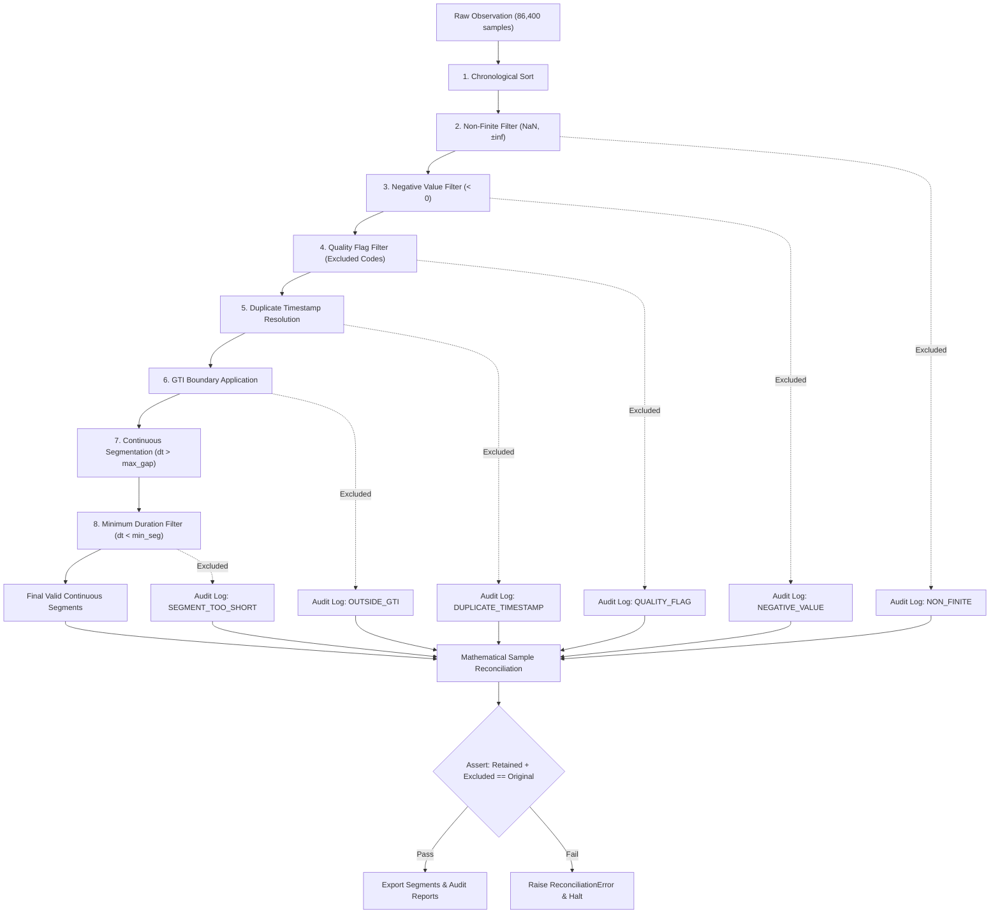

# Preprocessing & GTI-Aware Segmentation Methodology (Stage 7)

**Project:** `SOLARIS-A1` (Machine Learning-Based Solar Flare Detection and Pre-Flare Activity Analysis Using Aditya-L1 SoLEXS Observations)  
**Stage:** Stage 7 — Preprocessing and GTI-Aware Segmentation  
**Status:** PROVISIONAL (Development Mode) — Requires Gate G4 Human Approval for Final Run  

---

## 1. Overview and Core Scientific Principles

Stage 7 implements reproducible, audit-verified preprocessing for Level-1 Aditya-L1 SoLEXS solar X-ray light-curve observations. The primary objectives are:
1. Filter non-physical, corrupt, or invalid samples without mutating raw data.
2. Restrict continuous analysis strictly to confirmed Good Time Intervals (GTIs).
3. Partition valid observations into continuous, uninterrupted segments at confirmed cadence thresholds.
4. Enforce strict mathematical sample conservation: every single sample from raw input to final output is accounted for in auditable logs.

### Absolute Scientific Prohibitions
- **Zero Raw File Mutation:** Raw files under `data/raw/` are accessed in read-only mode (`mode='readonly'`). SHA-256 hashes are verified before and after execution.
- **Zero Interpolation:** Data points are never estimated, reconstructed, forward-filled, back-filled, or interpolated across gaps.
- **Zero Gap Bridging:** Telemetry gaps, night passes, and dropouts are treated as definitive boundaries. No gap is bridged.
- **Zero Silent Dropping:** Every excluded sample is logged with its original row index, timestamp, exclusion reason, and numeric value.
- **Detector Independence:** SDD1 and SDD2 detectors have distinct physical geometries and GTI tables. SDD2 GTI intervals are never substituted for SDD1.

---

## 2. Preprocessing Pipeline Architecture

The preprocessing sequence operates sequentially on raw light-curve tables:

---

## 3. Step-by-Step Filter Specifications

### Step 1: Chronological Sorting (`sort_by_time`)
- **Action:** Inspects the timestamp array (`TIME`). If monotonically increasing, proceeds without reordering. If out-of-order samples exist, performs a stable ascending sort.
- **Exclusion:** Zero samples dropped. Audit records `was_reordered: true/false`.

### Step 2: Non-Finite Sample Exclusion (`exclude_non_finite`)
- **Action:** Identifies samples where $\sim\text{isfinite}(x)$, including IEEE 754 `NaN`, `+Inf`, and `-Inf`.
- **Reasoning:** Telemetry dropouts and uninitialized detector reads often register as NaNs (4,849 observed on `2026-10-18`). Passing non-finite numbers into feature engineering introduces non-invertible matrices and calculation crashes.
- **Exclusion Reason:** `NON_FINITE`.

### Step 3: Negative Value Exclusion (`exclude_negative`)
- **Action:** Identifies counts $C_i < 0.0$.
- **Reasoning:** X-ray photon arrivals are inherently Poisson counting processes ($C_i \in \mathbb{N}_0$). Negative values indicate corrupted reads or unphysical background subtraction.
- **Constraint:** Samples are strictly removed; clipping to zero is prohibited.
- **Exclusion Reason:** `NEGATIVE_VALUE`.

### Step 4: Quality Flag Exclusion (`exclude_flagged`)
- **Action:** Matches instrument flag columns against a human-approved list of rejected integer bitmasks.
- **Current Status:** In the Level-1 `RATE` table, no dedicated flag column exists (`quality_flag_column = null` in `column_roles.yaml`). In development runs, this filter passes all samples.
- **Exclusion Reason:** `QUALITY_FLAG`.

### Step 5: Duplicate Timestamp Resolution (`resolve_duplicate_timestamps`)
- **Action:** Evaluates identical consecutive or non-consecutive timestamps $t_i = t_j$.
- **Policy Options:**
  - `ERROR` (Default): Raises [`DuplicateTimestampError`](file:///c:/Users/melvi/Desktop/SOLARIS-A1/src/solar_flare/preprocessing/filters.py) and halts processing.
  - `KEEP_FIRST`: Retains the first observed record and discards duplicates.
  - `KEEP_LAST`: Retains the latest observed record and discards preceding duplicates.
- **Exclusion Reason:** `DUPLICATE_TIMESTAMP`.

### Step 6: Good Time Interval Application (`apply_gti`)
- **Action:** Filters samples against paired GTI intervals $[S_k, E_k]$.
- **Boundary Inclusion Options (Decision D-17):**
  - `START_INCLUSIVE_STOP_EXCLUSIVE` (Provisional Default): $S_k \le t < E_k$.
  - `START_EXCLUSIVE_STOP_INCLUSIVE`: $S_k < t \le E_k$.
  - `BOTH_INCLUSIVE`: $S_k \le t \le E_k$.
- **Empty GTI Rule:** If a GTI table has zero rows (e.g. `AL1_SOLEXS_20261018_SDD1_L1.gti.gz`), zero samples are retained. The audit records: `"GTI EMPTY — no samples retained for this file"`. No cross-detector substitution is permitted.
- **Exclusion Reason:** `OUTSIDE_GTI`. Adds `gti_flag = True` to retained records.

### Step 7: Continuous Cadence Segmentation (`segment_continuous`)
- **Action:** Computes consecutive timestamp deltas $\Delta t_i = t_{i+1} - t_i$. Splits the series into distinct segments whenever:
  $$\Delta t_i > \text{max\_gap\_seconds}$$
- **Provisional Default:** $\text{max\_gap\_seconds} = 2.0\text{ s}$ (nominal cadence = $1.0\text{ s}$). Any gap strictly $> 2.0\text{ s}$ induces a segment split.
- **No Gap Bridging:** Missing points are never interpolated. Each segment is an uninterrupted, physically continuous observation block.

### Step 8: Minimum Segment Duration Filtering
- **Action:** Evaluates segment physical duration:
  $$D_{\text{seg}} = t_{\text{end}} - t_{\text{start}}$$
- **Provisional Default:** $\text{min\_segment\_seconds} = 60.0\text{ s}$ (matching sliding window length $W = 60\text{ s}$ in Task A).
- **Reasoning:** Segments shorter than the analysis window cannot produce complete, unpadded feature vectors in downstream Stage 8 feature extraction.
- **Exclusion Reason:** `SEGMENT_TOO_SHORT`. All samples within discarded short segments are logged.

---

## 4. Mathematical Sample Conservation and Audit Trail

Every file run enforces an exact mathematical invariant:

$$N_{\text{original}} = N_{\text{retained}} + \sum_{r \in \text{Reasons}} N_{\text{excluded}}(r)$$

Where reasons comprise:
$$\{\text{NON\_FINITE}, \text{NEGATIVE\_VALUE}, \text{QUALITY\_FLAG}, \text{DUPLICATE\_TIMESTAMP}, \text{OUTSIDE\_GTI}, \text{SEGMENT\_TOO\_SHORT}\}$$

If $N_{\text{retained}} + N_{\text{excluded}} \ne N_{\text{original}}$, the pipeline raises [`ReconciliationError`](file:///c:/Users/melvi/Desktop/SOLARIS-A1/src/solar_flare/preprocessing/audit.py) and halts immediately.

### Generated Audit Deliverables
For each processed file stem (e.g. `AL1_SOLEXS_20261018_SDD2_L1`), three audit artifacts are created in `results/preprocessing/`:
1. `audit_<stem>.csv`: Row-by-row table of every sample excluded with original row index, timestamp, value, and explanation.
2. `audit_<stem>.json`: Machine-readable summary with configuration parameters, SHA-256 hashes before and after, sample counts, and segment metadata.
3. `audit_<stem>.md`: Formatted human-readable report with sample retention tables, percentage breakdowns, and segment catalogues.

---

## 5. Segment Storage and Format

Segments are stored in `data/processed/segments/<stem>/segment_<NNN>.csv`.
- **Format:** CSV is utilized because `pyarrow` is absent from `requirements.txt`.
- **Naming:** Deterministic zero-padded indexing: `<stem>_seg_<NNN>.csv`.
- **Provenance Header:** Each CSV contains original columns plus `gti_flag`, `segment_id`, and `status` (`PROVISIONAL` or `APPROVED`).

---

## 6. Known Scientific Limitations

1. **Single Observation Date:** The current dataset comprises only `2026-10-18`. Generalizability across solar solar cycles and varying background conditions requires multi-epoch observations.
2. **Telemetry Dropouts:** 4,849 NaN samples were observed during night-to-day transitions, resulting in segmentation across orbital passes.
3. **Orbital Night Passes:** Ground and satellite occultation creates ~1,200–1,800 s telemetry gaps, naturally bounding maximum continuous segment durations to ~3,000–4,000 s.

---

## 7. Gate G4 Human Approval Requirements

To promote preprocessing from **PROVISIONAL (DEVELOPMENT)** to **APPROVED (FINAL)**, the human student researcher must:
1. Confirm Gate G1 (column roles: `TIME`, `COUNTS`, and GTI columns in `config/column_roles.yaml`).
2. Confirm Gate G2 (quality thresholds in `config/decisions.yaml`).
3. Approve Decision **D-14**:
   - `max_gap_seconds` (recommended: `2.0 s`).
   - `min_segment_seconds` (recommended: `60.0 s`).
4. Approve Decision **D-17**:
   - `gti_boundary_convention` (recommended: `START_INCLUSIVE_STOP_EXCLUSIVE`).
5. Set `status: APPROVED` and `approved_by: <Researcher Name>` in `config/decisions.yaml`.
